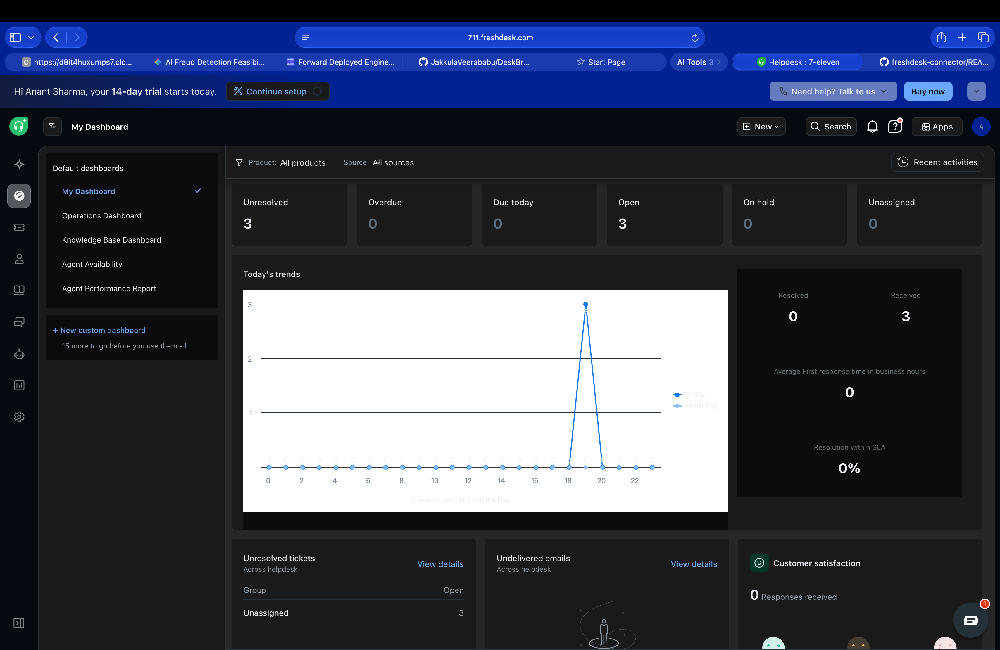

# Freshdesk Connector

A read-only MCP connector for Freshdesk. List, fetch, and search tickets, contacts, and agents using API-key auth, built-in rate limiting, automatic retries, and pagination. Made for Razorpay Agent Studio.

---

## Why this exists

A merchant support agent needs read access to Freshdesk without the risk of accidental writes. This connector gives it exactly 11 read-only tools across tickets, contacts, and agents. A prompt-injected agent cannot create, update, or delete anything because those endpoints don't exist in the server at all.

---

## Tools at a glance

| Area | Tool | What it does |
|---|---|---|
| Tickets | `freshdesk_list_tickets` | Paginated list with status, priority, and email filters |
| Tickets | `freshdesk_get_ticket` | Full ticket by ID with optional conversation thread |
| Tickets | `freshdesk_search_tickets` | Structured query search across all tickets |
| Tickets | `freshdesk_get_conversations` | All replies and notes on a ticket |
| Tickets | `freshdesk_list_ticket_fields` | Discover custom fields in your portal |
| Contacts | `freshdesk_get_contact` | Single contact by ID |
| Contacts | `freshdesk_list_contacts` | Paginated contact list with filters |
| Contacts | `freshdesk_search_contacts` | Autocomplete search by name, email, or phone |
| Agents | `freshdesk_list_agents` | All agents in the portal |
| Agents | `freshdesk_get_agent` | Single agent by ID |
| Agents | `freshdesk_whoami` | Identify which agent owns the API key |

Full input/output schemas: [docs/mcp-tool-spec.md](docs/mcp-tool-spec.md)
What the agent can and cannot do: [docs/agent-capabilities.md](docs/agent-capabilities.md)

---

## Live demo



---

## Quick start

### 1. Get a Freshdesk API key

1. Sign up for a free trial at [freshdesk.com](https://freshdesk.com), no credit card needed.
2. Your domain is the part before `.freshdesk.com` in your URL, for example `acme`.
3. Click your profile picture top-right, go to Profile Settings, scroll to the bottom, and click View API Key.

### 2. Install

```bash
git clone https://github.com/your-org/freshdesk-connector.git
cd freshdesk-connector
npm install
```

### 3. Configure

```bash
cp .env.example .env
```

Open `.env` and fill in two values:

```dotenv
FRESHDESK_DOMAIN=yourcompany        # subdomain only, not the full URL
FRESHDESK_API_KEY=your_api_key_here
```

The `.env` file is git-ignored and never committed. See `.env.example` for all available options.

### 4. Run the tests

```bash
npm test
```

All 69 tests use a mocked HTTP client so no real Freshdesk account or network access is needed.

### 5. Start the MCP server

```bash
npm start
```

You should see this on stderr:

```
[freshdesk-connector] Starting up
  Base URL : https://yourcompany.freshdesk.com/api/v2
  API key  : abcd...wxyz
  Transport: stdio
[freshdesk-connector] MCP server ready (stdio transport).
```

The server speaks MCP JSON-RPC over stdin/stdout and is ready to receive tool calls.

---

## Wire into Agent Studio

### Option A: stdio (recommended)

Add this to your Agent Studio or Claude Desktop `mcp.json`:

```json
{
  "mcpServers": {
    "freshdesk": {
      "command": "node",
      "args": ["/absolute/path/to/freshdesk-connector/src/index.js"],
      "env": {
        "FRESHDESK_DOMAIN": "yourcompany",
        "FRESHDESK_API_KEY": "your_api_key_here"
      }
    }
  }
}
```

Replace `/absolute/path/to/freshdesk-connector` with the real path on your machine.

### Option B: HTTP/SSE (for remote or multi-client use)

```bash
MCP_TRANSPORT=http MCP_HTTP_PORT=3000 npm start
```

Then point your MCP client at `http://localhost:3000/sse`.

| Endpoint | Purpose |
|---|---|
| `GET /sse` | Opens SSE stream, server sends back a session ID |
| `POST /message?sessionId=<id>` | Routes JSON-RPC to an active session |
| `GET /health` | Liveness probe, returns `{ status: "ok" }` |

---

## Design decisions

### Read-only by construction

No write tools exist. A prompt-injected agent cannot modify tickets because there is no code path to do so. It is not a permission check or a missing scope, it is just no implementation.

### Fail-fast credential validation

The connector validates `FRESHDESK_DOMAIN` and `FRESHDESK_API_KEY` at startup before registering any tools. If credentials are missing or obviously invalid (placeholder value, too short), it throws a clear error immediately rather than surfacing a cryptic 401 on the first tool call.

### Redacted key logging

The API key is never logged in full. Only the first 4 and last 4 characters appear in logs (`abcd...wxyz`) so you can confirm which key is active without exposing it.

### Two-layer rate limiting

Bottleneck queues all outbound calls (max 5 concurrent, min 200 ms between requests). axios-retry handles `429` and transient `5xx` responses with exponential backoff and honours the `Retry-After` header when Freshdesk sends one.

### Pagination built in

`fetchAllPages` auto-paginates any list endpoint until it gets a partial or empty page. Page size is capped at 100 (Freshdesk's maximum) and the connector supports up to 300 pages, so 30,000 records total.

---

## Rate limiting

| Condition | What happens |
|---|---|
| Normal traffic | Bottleneck limits to max 5 concurrent calls, min 200 ms between them |
| HTTP 429 | Reads `Retry-After` header, retries up to 3 times with exponential backoff |
| HTTP 5xx | Same exponential backoff |
| HTTP 401, 403, 404 | Raised immediately, never retried |

Freshdesk rate limits by plan:

| Plan | Requests per minute |
|---|---|
| Free / Sprout | 100 |
| Growth | 100 |
| Pro | 200 |
| Enterprise | 400 |

The default 200 ms delay (5 req/s) keeps usage well within the most restrictive plan.

---

## Environment variables

| Variable | Required | Default | Description |
|---|---|---|---|
| `FRESHDESK_DOMAIN` | Yes | | Subdomain only, for example `acme` not `acme.freshdesk.com` |
| `FRESHDESK_API_KEY` | Yes | | API key from Freshdesk Profile Settings |
| `FRESHDESK_MAX_CONCURRENT` | No | `5` | Max simultaneous outbound API calls |
| `FRESHDESK_MIN_DELAY_MS` | No | `200` | Min ms between requests |
| `MCP_TRANSPORT` | No | `stdio` | `stdio` or `http` |
| `MCP_HTTP_PORT` | No | `3000` | Port used when transport is http |
| `LOG_LEVEL` | No | `info` | Logging verbosity |

---

## Project structure

```
freshdesk-connector/
├── src/
│   ├── index.js              # Entry point, transport selection and startup validation
│   ├── mcpServer.js          # MCP server, tool registry, dispatch pipeline
│   ├── auth/
│   │   └── apiKey.js         # Credential validation, Basic Auth config, key redaction
│   ├── tools/
│   │   ├── tickets.js        # Freshdesk Tickets API primitives
│   │   ├── contacts.js       # Freshdesk Contacts API primitives
│   │   └── agents.js         # Freshdesk Agents API primitives
│   ├── utils/
│   │   ├── httpClient.js     # Axios with Bottleneck rate limiter and axios-retry
│   │   ├── pagination.js     # Page param helpers and fetchAllPages
│   │   ├── validate.js       # Zod-based input validation for all MCP tools
│   │   └── logger.js         # Structured JSON logger that writes to stderr
│   └── __tests__/
│       ├── auth.test.js
│       ├── pagination.test.js
│       ├── tickets.test.js
│       ├── contacts.test.js
│       ├── agents.test.js
│       └── validate.test.js
├── docs/
│   ├── mcp-tool-spec.md      # Full MCP tool specification for all 11 tools
│   └── agent-capabilities.md # What the agent can and cannot do
├── .env.example
├── .gitignore
├── package.json
└── README.md
```

---

## Running tests

```bash
npm test                    # all 69 tests
npm test -- --verbose       # show each test name
npm test auth               # auth module only
```

### Test strategy

Six test files cover every module independently:

| File | Covers |
|---|---|
| `auth.test.js` | Credential validation, key redaction, missing and placeholder key errors |
| `pagination.test.js` | Page param clamping, multi-page accumulation, loop termination |
| `tickets.test.js` | All 5 ticket tools, status and priority decoration, search passthrough |
| `contacts.test.js` | All 3 contact tools, filter params, search min-length validation |
| `agents.test.js` | All 3 agent tools, whoami response shape |
| `validate.test.js` | Zod schema rejection of invalid inputs across all tools |

All tests mock the HTTP client so no real Freshdesk account or network connection is needed.

---

## Security

- No secrets in this repository. `.env` is git-ignored.
- Copy `.env.example` to `.env`, fill in your credentials, and keep the file local.
- The connector only ever logs a redacted key so the full value never appears in logs.
- All Freshdesk API calls go over HTTPS.
- Rotate your Freshdesk API key straight away if it ever shows up in `git log`.

---

## Assumptions and limitations

1. Read-only. No write, create, update, or delete operations are exposed. This is intentional.
2. Single portal. One connector instance maps to one Freshdesk subdomain. Run multiple instances for multiple portals.
3. Search cap. Freshdesk's Search API returns at most 1,000 results. Use `freshdesk_list_tickets` with pagination for larger result sets.
4. Attachments. Attachment metadata like URLs is returned, but binary file content is not fetched or proxied.
5. Node.js 18 or later is required. The connector uses ES modules and top-level await.
6. No orders or inventory. These are not native Freshdesk objects. An agent can infer order references from ticket custom fields, tags, or subject lines but there are no dedicated order tools.

---

## License

MIT
